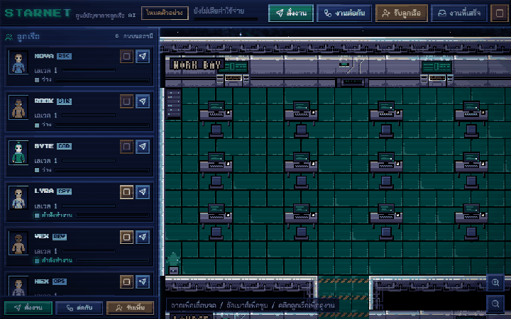

# STARNET

A pixel-art space station where every AI agent is a crew member. Give one a
task and they walk to a desk, sit down and type while the answer streams in,
then carry the finished work to the Outbox. The work is real: in Live mode each
crew member is a Claude call with its own system prompt.



**Live demo:** https://starnet-crew-control.netlify.app (opens in Demo mode, no key needed)

## What you can do

- **Assign tasks.** Six starter classes, each with its own system prompt:
  Researcher, Strategist, Coder, Copywriter, Reviewer, Ops. Up to 6 agents run
  at once; each has a Stop button, plus Stop All.
- **Watch them work.** Crew members walk around the station by A*. They sit at
  desks with glowing monitors while tokens stream, show a progress bar, level
  up with XP, and wander off to the Lounge (pool table, sofas, fish tank) when idle.
- **Collect results.** The Outbox lists finished work. Open any result to read
  it rendered, copy it, or download it as Markdown.
- **Recruit.** The Recruitment Bay lets you pick a class, callsign, uniform,
  skin, hair and model, then Summon: the new crew member beams in on the pad.
- **Chain them.** Pipeline mode runs up to four crew members in order (for
  example Researcher, then Strategist, then Copywriter). Each works at a Factory
  station and their output rides the conveyor to the next.
- **Desktop or phone.** Drag to pan, wheel or pinch to zoom, tap a crew member
  to focus them and open their card. The CRT scanlines can be toggled.

## Two modes

| Mode | Needs | What happens |
|---|---|---|
| **Demo** (default) | nothing | Scripted agents stream plausible output, so the whole station works instantly. An optional autopilot hands idle crew sample tasks. |
| **Live** | your Anthropic API key | Real calls to Claude with streaming. Model is per agent: `claude-haiku-4-5-20251001` (default), `claude-sonnet-5-5`, or `claude-haiku-5-5`. |

### Bring your own key

STARNET has no backend. In Live mode your browser calls
`https://api.anthropic.com/v1/messages` directly, using the official Anthropic
TypeScript SDK with the `anthropic-dangerous-direct-browser-access: true` header.

- The key is stored **only** in this browser's `localStorage`
  (`starnet.apiKey`) and is sent **only** to `api.anthropic.com`. Clear it any
  time in Settings.
- A **daily token guard** (default 200,000 tokens, configurable) refuses to start
  a task that could push you over the limit. It counts input and output tokens
  and holds back room for tasks that are still running.
- Output per task is capped (default 2,048 tokens).
- Errors are shown plainly: bad key, rate limit, overload, network, or a declined request.
- Use a key with a spend limit set in the Anthropic Console. Anyone with access
  to your browser profile can read `localStorage`.

## Setup

```bash
npm install
```

```bash
npm run fetch-assets
```

```bash
npm run dev
```

The fetched art is also committed under `public/assets`, so `fetch-assets` is
only needed to refresh it. Other scripts:

| Command | Does |
|---|---|
| `npm run build` | Type-check and build the static site into `dist/` |
| `npm test` | Unit tests for the event bus and the task scheduler (Vitest) |
| `node scripts/shots.mjs` | Playwright screenshots of every room and panel, desktop and 390 px |
| `node scripts/verify-live.mjs` | Live mode against a mocked API: streaming, 4 concurrent agents, bad key, rate limit, network error, spend guard |
| `node scripts/perf.mjs <url> 12 10 390 844 4` | FPS with 12 working agents on a throttled phone viewport |

## How it is built

- **Vite + TypeScript.** The world is **Phaser 3**. The panels are plain DOM
  with no framework, and lucide icons are inlined as SVG.
- **State:** a tiny typed event bus (`src/core/bus.ts`), a store persisted to
  IndexedDB (`src/core/store.ts`), and a pure task scheduler with an injected
  runner (`src/core/scheduler.ts`). The scheduler owns the queue, per-agent busy
  state, the concurrency cap and pipeline chaining. It coalesces stream deltas
  so the UI updates at most once per animation frame.
- **Art:** the CC0 tileset and body sprites are packed into a single runtime
  atlas. Each crew member's uniform, hair and skin are palette-swapped at
  runtime. Every missing prop is drawn procedurally in the tileset's own
  17-color palette, so it all reads as one 16-bit-era set. In-world labels use
  a hand-made 3x5 bitmap font.
- **Performance:** nearest-neighbor rendering with round pixels; static tiles
  are baked into one texture; particles are pooled by a Phaser emitter. Phaser
  and the Anthropic SDK are lazy chunks: the eager JS is about 22 KB gzipped,
  and the SDK (about 73 KB) downloads only in Live mode. Rendering pauses when
  the tab is hidden, but streams keep running. `prefers-reduced-motion` turns
  off drift, tweens and flicker.
- **Measured** (production build, headless Chromium): 12 agents working at
  once ran at 60 fps on desktop, and at 59 fps on a 390 px viewport with 4x CPU
  throttling.

## License and credits

Code: [MIT](LICENSE). Art: CC0 assets by ansimuz and the OpenGameArt "16x16
base sprites", plus original procedural art. Fonts: OFL. Icons: ISC. Full list
with links in [CREDITS.md](CREDITS.md).
